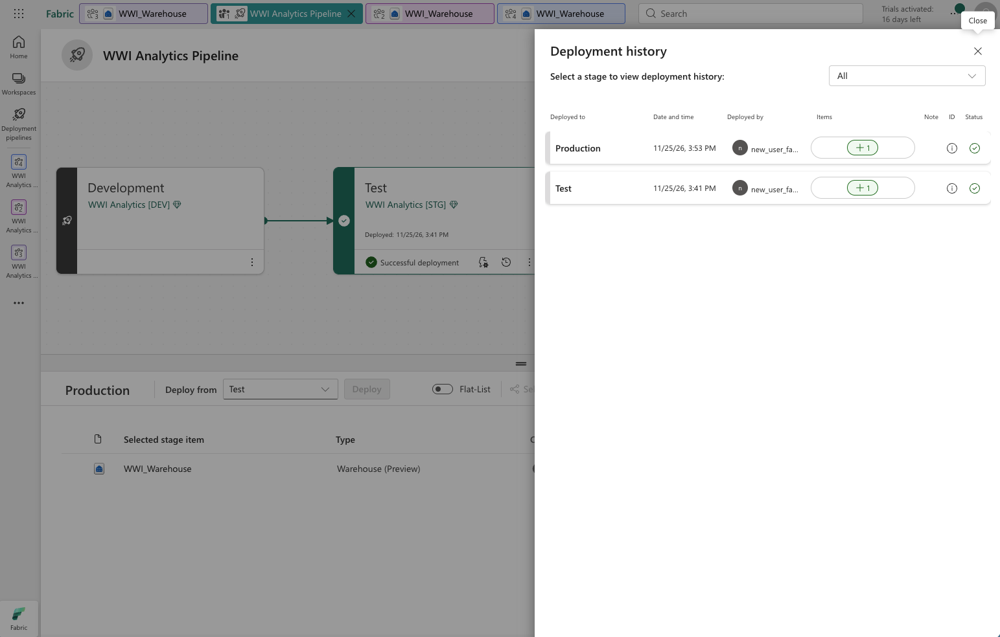

# wwi-fabric-sql

Production-grade Microsoft Fabric project on the **Wide World Importers** sample: Fabric Warehouse, CI/CD (Dev → Staging → Prod), Ontology, Data Agent and a Fabric App dashboard.

> 🚧 Work in progress. Full documentation, metrics and screenshots are added at the end of the project.

## Layout

| Path | Content |
|---|---|
| `fabric/` | Fabric items synced from the `WWI Analytics [DEV]` workspace (Git integration) |
| `sql/` | T-SQL to create, load (COPY INTO from Microsoft's public WWI parquet) and verify `WWI_Warehouse` |
| `docs/adr/` | Architecture Decision Records |
| `docs/images/` | Screenshots used in this README |

## Environments

| Stage | Workspace | Source |
|---|---|---|
| Dev | `WWI Analytics [DEV]` | Git-connected to `main` / `fabric/` |
| Staging | `WWI Analytics [STG]` | Deployment pipeline |
| Prod | `WWI Analytics [PROD]` | Deployment pipeline |

## Deployment pipeline

`WWI Analytics Pipeline` promotes items Development → Test → Production. Pipelines copy the warehouse schema but not its data, so each stage loads data with `sql/02_load_data.sql` and checks it with `sql/03_verify.sql` ([ADR-0002](docs/adr/0002-deployment-strategy.md)).

