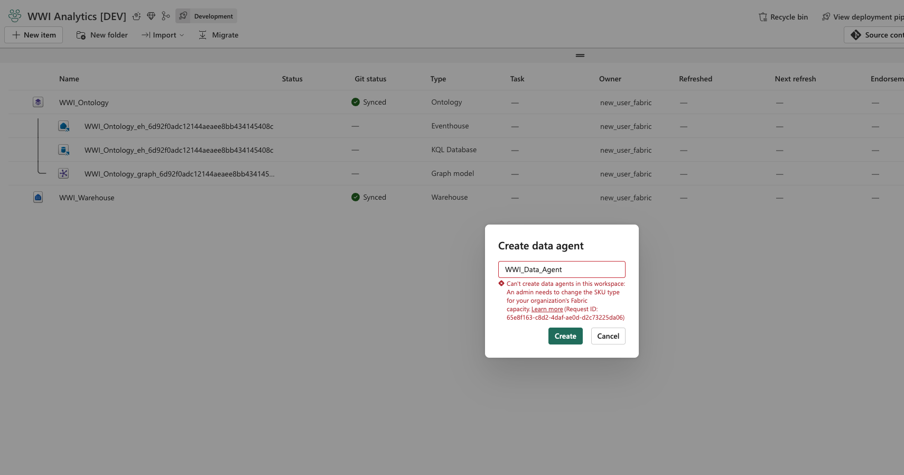

# ADR-0004: Claude data agent in a Fabric User Data Function

- **Status:** Accepted
- **Date:** 2026-11-27

## Context
Phase 5 adds a natural-language agent over `WWI_Warehouse`. The plan was a [Fabric Data Agent](https://learn.microsoft.com/en-us/fabric/data-science/concept-data-agent) using `WWI_Ontology` as a source. The project runs on a Fabric **trial** capacity, and Microsoft's [trial page](https://learn.microsoft.com/fabric/get-started/fabric-trial) excludes AI experiences, including Data agent. Creating one in `WWI Analytics [DEV]` failed with *"Can't create data agents in this workspace: An admin needs to change the SKU type"*:

## Options
1. **Buy a paid F2 capacity** (West US, same region as the data) only for the agent. It's the native experience, but costs about $0.36/hour and needs pausing discipline.
2. **Claude agent in a Fabric User Data Function (UDF)**, with the API key in Azure Key Vault. It runs on the trial, stays inside the workspace, and is promoted with the same pipeline.
3. **Claude agent in an Azure Function.** It works on any capacity, but it's a second platform to deploy and secure, outside the Fabric pipeline.

## Decision
Option 2. `WWI_Agent_Functions` (User data functions) in DEV exposes one function, `ask_wwi(question) -> dict`:

1. It reads `anthropic-api-key` from `kv-wwi-fabric-fc01` through a Fabric **generic connection** (`audienceType="KeyVault"`). The call runs as the Fabric user, who holds only the *Key Vault Secrets User* role on that vault.
2. It calls **Claude Haiku 5.5** (`claude-haiku-5-5`, $0.10 / $0.50 per million input/output tokens) with the star schema in the system prompt and one tool, `run_sql`.
3. `run_sql` runs Claude's query through the `WWIWarehouse` connection. Before anything reaches the warehouse, `validate_sql` accepts only a single `SELECT`/`WITH` with no comments, and rejects write, DDL and exec keywords such as `INTO`, `EXEC` and `OPENROWSET`. Results are capped at 50 rows.
4. The loop is capped at 6 model calls. The function returns the answer, the SQL it ran, and token usage with an estimated cost.

Source: [`fabric/WWI_Agent_Functions.UserDataFunction/function_app.py`](../../fabric/WWI_Agent_Functions.UserDataFunction/function_app.py), committed from Fabric Git integration. The SQL guard is covered by [`tests/test_validate_sql.py`](../../tests/test_validate_sql.py).

## Consequences
- **Cost is tiny and measured on every call.** "What was total revenue and profit by year?" took 2 model calls, 3,335 input and 483 output tokens, so about **$0.0006** per question. Tests in STG and PROD cost $0.000358 and $0.000531.
- **It ships through the existing pipeline.** The warehouse connection is stored by logical ID, so the deployed copies bind to the STG and PROD warehouses automatically. This was verified in both stages on 2026-11-27. The Key Vault connection needs no rebinding, because every stage reads the same vault.
- **The key never touches code or Git.** Rotating it means updating one Key Vault secret. Spend is capped by prepaid Claude Console credits (about $6.56) with auto-reload off, so the agent stops when the credits run out.
- **The ontology isn't used by this agent.** Claude gets the schema and join rules in its prompt instead. `WWI_Ontology` stays as the business layer for a native Fabric Data agent if the project moves to paid capacity.
- **The SQL guard is defense in depth, not the only control.** Queries run with the invoking user's warehouse permissions. Production should run the agent as an identity with read-only warehouse access.
- **No prompt caching.** The schema prompt is below Haiku's minimum cacheable size, so every call pays full input price. At these prices that costs less than the caching setup would.
- **Not covered:** a native Fabric Data agent, chat history across questions (each call is one question), and automated evals of answer quality.
